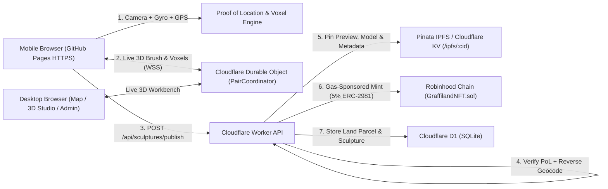

# GRAFFILAND — Location-Bound 3D Voxel Graffiti & Virtual Land

> Turn the physical world into a shared 3D voxel canvas. Wave your phone like a spatial spray-can over a live camera feed, verify you're really standing there using **Camera + GPS Proof of Location**, claim a **Virtual Land** parcel, and mint gas-sponsored 3D NFTs to **IPFS** and **Robinhood Chain** with a **5% resale royalty**.

- **Live App (GitHub Pages)**: https://maximusmaximus.github.io/graffiland/
- **Live Edge API & WebSocket Hub (Cloudflare Workers)**: https://graffiland-api.maxinfeld-artshow.workers.dev

---

## What It Does

GRAFFILAND splits into two purpose-built interfaces depending on the device you open it on:

### 1. Mobile Full-Screen AR Sculpting Studio
Sculpting and publishing **require a mobile device** with a camera, gyroscope, and GPS:
- **Ultra-Minimal `"i"` Canvas**: Opens directly into a full-screen (`100vw × 100dvh`) rear-camera view with a transparent Three.js WebGL layer and only an **`ℹ️` Info & Terms** button plus a compact tool toggle (`🎨`) so the artwork owns the screen.
- **Tap-to-Set Start Surface (`📌`), Fluid Tool Carousel, Hold Eraser (`🧽`), Trash Clear (`🗑️`), & Lock Transform (`✅`)**: Tap anywhere on your rear-camera view (floor, table, wall, scene spot, or existing block face) to lock a glowing 3D Start Surface Ring and aligned grid/shadow plane right onto that real surface — or toggle **Free 3D** mid-air mode at any time from the top-left surface pill (`+ Seed` drops an immediate anchor voxel). Glide smoothly across the centered bottom tool carousel (`Brush → Stack → Erase → Lock & Scale → Preview → Agent Code → Publish`) via fluid multi-step touch swiping (arrow steppers are displayed only on non-touch interfaces), or open the menu (`🎨`) for **hold-to-erase** (`🧽`), **Trash Bin** clear canvas (`🗑️`), and the **Check Mark (`✅`)** lock toggle to scale (`0.25x–2.0x`), rotate, and reposition your entire sculpture via 1-finger drag, 2-finger pinch/twist, or sliders before clicking `✅` again to return to drawing mode. Hold/tap the active tool to sweep continuous, linearly interpolated **4x resolution (`0.05m` grid)** voxel strokes with zero skipping in **matte**, **neon**, or **glass** finishes (up to `4,096` blocks within a **`10,000 × 10,000 × 10,000` block** area per sculpture). Move your phone around as guided by the **bottom-right Scene Coverage Window (`📡`)** until `9/12` view sectors fill (`100% LOCKED`) for optimal scene analysis, GPS/altitude refinement, and precise placement.
- **Tool Readiness & Prerequisite Notifications (`🔒`)**: Across both Mobile AR Studio and Desktop Pair Workbench, tools whose prerequisites aren't met yet (such as Stack/Eraser/Clear/Lock before placing blocks, Foreground Occlusion before camera readiness, or Publish before GPS, space mapping, and Google Sign-In) appear greyed out and display a direct notification explaining what step is needed first when selected.
- **Bottom-Left Public Area Map & Google Maps Navigation (`🗺️` / `🧭`)**: Tap the bottom-left **Map** icon anytime inside the mobile AR studio to view public sculptures and highlighted **Virtual Land parcels (`GH-...`)** in your area (`5km` radius or global view), click any pin, parcel rectangle, or area card to review its interactive **3D voxel model**, inspect its dedicated **Virtual Land Parcel mini-map** and clickable **on-chain transaction (`Tx Hash` / Explorer)**, and tap **Navigate** to open turn-by-turn **Google Maps** directions right to that sculpture's physical coordinates.
- **Face-Snapping Voxel Stacker (`🧱`)**: Raycasts directly from your reticle onto existing voxels in your sculpture, projecting a wireframe ghost block onto the targeted face so you can tap or hold down the Stack button (Key Button or menu) to draw and stack towers, arches, and pixel sculptures continuously.
- **Location AR Preview Mode (`👁️`)**: Queries nearby published (non-hidden) sculptures within `300m` of your GPS fix and projects every phone-made 3D sculpture at its real east/north spatial offset around you so you can walk around street graffiti left at that spot.
- **Copy Agent Sculpture Code (`📋`, Final Tool Before Publish)**: Generate and copy a location-anchored code (`GRF-...`) from your live GPS spot. Any external AI agent (e.g. Grok Bot) can inspect all available 4x grid tools, 12 colors, and block finishes via `/api/agent/spec`, build a 3D voxel draft via `POST /api/agent/sessions/:code/sculpture`, and stream it straight to your phone — while requiring **you** to review in AR and tap Publish on your own mobile device.
- **Auto-Saved Drafts (`💾`)**: All in-progress voxels, title, description, and locked surface anchors automatically save locally (`localStorage`) on every edit and sync to your Google account's cloud drafts (`sculpture_drafts`) via `/api/drafts` so unfinished work is preserved across refreshes or sessions and can be inspected on desktop (`💾 Drafts`) before minting.
- **Gas-Free Publish (`🚀`)**: Sign in with **Google**, add a limited-terms title (`3–48` chars) and description (`10–240` chars, max `45` words), accept the Virtual Land Terms, and publish directly to IPFS + Robinhood Chain. You receive the minted ERC-721 NFT straight in your wallet at zero gas cost.

### 2. Desktop Map Explorer & QR Pair Modal
Opening GRAFFILAND on a desktop viewport defaults strictly to the interactive **Map & Large-View Explorer**:
- **Map-Only View (`🗺️` + Surrounding Sculptures)**: Renders glowing **Geohash-8 Virtual Land parcel polygons**, clickable sculpture pins around your location (`Near Me` vs `Global`), and a **Sculptures Around You** panel. Click any pin, parcel, or surrounding card to inspect its interactive **3D model**, **Virtual Land parcel**, **on-chain transaction**, and **Google Maps directions**.
- **Mobile-Required Banner (`📱`)**: Notifies desktop visitors that mobile (camera, gyroscope, and GPS Proof of Location) is required for full functionality — creating/capturing 3D sculptures and publishing them on-chain.
- **QR Pair Modal (`🔗 Pair Phone · Large 3D View`)**: Opens a wide modal with a QR pairing code and 6-character code over WebSockets (`/ws`) so you can pair your mobile phone and view your strokes building in a larger live 3D workspace while drawing on mobile.
- **Session & Last View Persistence**: Automatically remembers your login session, map viewport (center/zoom), area filter, last interacted sculpture (`Last Viewed`), and active QR Pair / inspection modal across visits (with an optional `🛡️ Admin` modal shown only for authorized `ADMIN_EMAILS`).

---

## How It Works Under the Hood



### 1. Camera + GPS Proof of Location (Anti-Spoof Presence)
Instead of trusting raw GPS coordinates alone (which can be mocked), GRAFFILAND captures multi-sensor evidence during the sculpting session via [`ProofOfLocationTracker`](client/src/components/ProofOfLocation.js) and verifies it in [`verifyAndEnrichLocation`](server/services/pol.mjs):

1. **Camera-Gyro Optical-Flow Correlation**: Every `450ms`, the client samples a downsampled `48×36` frame from the live camera stream and measures horizontal image displacement (`SAD` shift match) against simultaneous `DeviceOrientationEvent` yaw deltas (`Δalpha`). Physically panning a phone through real space produces correlated image motion; static photos or GPS spoofers without real camera parallax score poorly.
2. **Astronomical Solar vs. Horizon Luminance Check**: Using `(lat, lng, UTC timestamp)`, the backend computes the sun's expected altitude angle (`daylight`, `twilight`, or `night`) and compares it against the upper-horizon brightness of the live camera feed.
3. **GPS Trajectory Sanity**: Tracks rolling GPS fixes throughout the sculpting session and rejects impossible teleport speeds (`>= 60 m/s` between samples).
4. **Environmental Fingerprint**: Extracts a 5-color ambient scene palette and a 64-bit perceptual `visualDHash` (preserving street privacy while binding the visual atmosphere to the proof).
5. **Cryptographic Commitment**: Combines all sensor, reverse-geocoded Nominatim address, solar, and timestamp fields into a `0–100` PoL score and `keccak256` `proofHash` embedded in both IPFS metadata and the Robinhood Chain NFT contract.

### 2. Geohash Virtual Land Parcels
Every `(lat, lng)` coordinate encodes into an **8-character Geohash** (e.g., `GLAND-9Q8YYK8D`), partitioning Earth into ~12m × 12m spatial cells.
- Publishing a sculpture binds the NFT to that `landParcelId` on-chain (`bytes32`), tracks the parcel claimant history in D1 (`land_parcels`), and renders the exact decoded bounding box rectangle on the desktop map.

### 3. Google Sign-In, Portable Wallets & Marketplace-Ready Robinhood NFTs
- **Google-Only Auth**: Users sign in via Google Identity Services (`GOOGLE_CLIENT_ID`, with an optional local dev fallback when unset).
- **Zero-Friction Custodial & Self-Custody Wallets**: On first sign-in, the backend generates an EVM wallet encrypted with **AES-256-GCM** (`WALLET_ENCRYPTION_KEY`) per Google account. Users can mint directly to a custom payout EVM wallet, export their private key, **import into MetaMask (`wallet_watchAsset`)**, or **transfer** any sculpture NFT (`POST /api/sculptures/:id/transfer`) to any external `0x...` wallet or marketplace.
- **Standard ERC-721 + 3D `.glb` + 5% Resale Royalty ([GraffilandNFT.sol](contracts/GraffilandNFT.sol))**:
  - Inherits OpenZeppelin `ERC721`, `ERC721Enumerable`, `ERC721URIStorage` (**IERC-4906** metadata updates), `ERC721Royalty` (**ERC-2981**), `Ownable`, and **EIP-7572** `contractURI()` collection metadata (`/api/contract/metadata.json`).
  - Exports every voxel sculpture as a standard **glTF 2.0 binary (`.glb`)** model (`/api/sculptures/:id/model.glb` + pinned to IPFS as `animation_url` in ERC-721 metadata at `/api/sculptures/:id/metadata.json` & `/api/tokens/:tokenId.json`) so sculptures render interactively on OpenSea, Rarible, Blockscout, MetaMask, and 3D viewers.
  - Enforces `RESALE_FEE_BPS = 500` (**5.00%**) across default and per-token `royaltyInfo`, plus live `ownerOf(tokenId)` **ownership sync** (`POST /api/sculptures/:id/sync-ownership`) so secondary marketplace sales reflect immediately.

### 4. Elevation Anchoring, Occlusion, Reflections & Real Shadows
- **Elevation & Altitude Lock (`shared/sculpture.mjs`, `server/services/pol.mjs`)**: Captures browser GPS `altitude` + `altitudeAccuracy`, cross-checks terrain elevation to compute height above ground (`AGL`), and records vertical voxel bounds (`sculptureVerticalMinM..MaxM`) in IPFS metadata so sky-high or multi-story sculptures stay locked to their vertical level in AR Preview.
- **Visible Origin Lock, Occlusion & Origin-Blocked Guard (`ForegroundOcclusion.js`)**: Renders an enhanced 3D sculpture origin ring & footprint beacon behind a background-aware `128×96` gyro-compensated occlusion layer (`z-index: 4`) so moving or stationary objects in front hide occluded sculpture segments cleanly and block starting new paint strokes with an immediate `"Origin is blocked"` alert until cleared.
- **Live Grayscale Unmapped Preview & Mapping Completion (`ProofOfLocation.js`, `MobileStudio.jsx`)**: Renders unmapped angular regions of your live camera feed as a real-time grayscale veil (`8×6` viewport grid mapped to `16×12` angular coverage) that turns full-color as you sweep, plus grayscale vs. color tiles inside the bottom-right Scene Coverage Window, announcing **"Mapping complete for this space!"** once optimal coverage (`100%`) is reached.
- **Live Location Reflections & Solar Shadows (`VoxelEngine3D.js`, `MobileStudio.jsx`)**: Generates equirectangular `PMREMGenerator` environment maps from the live camera feed (`256×128` off-stroke refresh, `PBR` clearcoat glass, metallic neon, matte reflections) paired with astronomical solar-azimuth directional lights and invisible `ShadowMaterial` shadow catchers aligned to your selected start surface.

### 5. Camera-Locked Encrypted Location Chat (Server-Blind E2EE)
- **Camera-Only Admission (`shared/chatPolicy.mjs`)**: Chat boards only open when viewing a sculpture in person on a mobile device (`<= 75m`, altitude-matched, live camera frames) and directly selecting its 3D voxels inside the AR camera viewport via `THREE.Raycaster`. Desktop visitors see only locked post counts (`🔒`).
- **True Zero-Server-Knowledge (`client/src/utils/chatCrypto.js`)**: Messages are encrypted client-side using a 256-bit `AES-256-GCM` room key (`K_room`) bound with `ECDSA P-256` signatures and AAD integrity checks. Database tables hold **zero plaintext** and **zero room keys**.
- **Hybrid Key Distribution**: Creators and admitted visitors automatically wrap `K_room` to incoming physical viewers via ephemeral **`ECDH P-256` + `HKDF-SHA256`**, plus an optional creator **On-Site Visual Clue (`PBKDF2-SHA256`, 210k iterations)** for 24/7 solo unlocking without exposing clue answers to the server.
- Read the full cryptographic specification in [`docs/ENCRYPTED_LOCATION_CHAT.md`](docs/ENCRYPTED_LOCATION_CHAT.md).

### 6. Agent Sculpture Staging & 4x Voxel Resolution (`📋`)
- **4x High-Density Sculptures (`shared/constants.mjs`)**: Voxel grid resolution is `0.05m` (`4x` sharper than `0.2m`, supporting up to `4,096` blocks via O(1) incremental mesh diffing and interpolated brush batches) inside a strict `10,000 × 10,000 × 10,000` block area cap (`±250m`), backed by `1920×1080` live camera capture, `256×128` reflection cubemaps, `128×96` ghost-free foreground occlusion, `1024×1024` shadow maps, and mobile-optimized DPR (`<= 2`) rendering.
- **Location-Anchored Agent Handoff (`shared/agentService.mjs`)**: Selecting the final **Copy Agent Code (`📋`)** tool before Publish creates an expiring `GRF-...` session anchored to your GPS coordinates (`POST /api/agent/sessions`). Agents read full tool/color/block specs at `GET /api/agent/spec` and `GET /api/agent/sessions/:code`, stage structured geometry via `POST /api/agent/sessions/:code/sculpture`, and push it live to your phone for final human AR inspection & mobile-only minting (`agentCanStageOnly: true`).

### 7. Xero Emoji UI System
Every icon across mobile HUD triggers, map pins, desktop tabs, and modals is rendered using [`xeroemoji`](https://github.com/maximusmaximus/xeroemoji) via [`XeroIcon.jsx`](client/src/components/XeroIcon.jsx) (with automatic PNG and glyph fallback).

---

## Repository Structure

| Path | Purpose |
| :--- | :--- |
| `client/` | React + Three.js + Leaflet + Vite frontend (`MobileStudio`, `DesktopHub`, `MapView`, `PairWorkbench3D`, `AdminPanel`) |
| `worker/` | Cloudflare Worker API, D1 schema (`schema.sql`), WebCrypto JWT/AES (`crypto.js`), and `PairCoordinator` Durable Object |
| `server/` | Standalone Node/Express + `node:sqlite` + WebSocket server for local HTTPS development |
| `shared/` | Shared constants, Robinhood Chain configs, and Limited Terms moderation policy |
| `contracts/` | `GraffilandNFT.sol` (ERC-721 + 5% ERC-2981 royalty) plus `solc`/`ethers` compile & deploy scripts |
| `tests/` | End-to-end automated verification suite (`node --test`) |

---

## Secret Keys & Security Model

Because this repository is public, **private keys and API secrets are never committed to git**. Instead:
- **Cloudflare Worker Secrets** hold runtime secrets (`SESSION_SECRET`, `WALLET_ENCRYPTION_KEY`, `ADMIN_EMAILS`, and optional `PINATA_JWT`, `GOOGLE_CLIENT_ID`, `ROBINHOOD_RELAYER_PRIVATE_KEY`, `ROBINHOOD_CONTRACT_ADDRESS`).
- **GitHub Repository Secrets / Variables** mirror deployment settings without exposing them in source files.

To configure production Google OAuth, Pinata IPFS, or live Robinhood Chain minting on the Worker:
```bash
npx wrangler secret put GOOGLE_CLIENT_ID --config worker/wrangler.toml
npx wrangler secret put PINATA_JWT --config worker/wrangler.toml
npx wrangler secret put ROBINHOOD_RELAYER_PRIVATE_KEY --config worker/wrangler.toml
npx wrangler secret put ROBINHOOD_CONTRACT_ADDRESS --config worker/wrangler.toml
```

---

## Local Development & Deployment

1. **Install & Run Locally (HTTPS + WSS for Wi-Fi mobile testing)**:
   ```bash
   cp .env.example .env
   npm install
   npm run dev
   ```
   Open `https://localhost:5173` on desktop or `https://<your-lan-ip>:5173` on mobile.

2. **Deploy Updates**:
   ```bash
   # Deploy frontend bundle to GitHub Pages
   npm run deploy:pages

   # Apply D1 schema & deploy Cloudflare Worker + Durable Object
   npm run deploy:worker:db
   npm run deploy:worker

   # Compile & deploy GraffilandNFT.sol to Robinhood Chain Testnet (46630) or Mainnet (4663)
   npm run contract:compile
   npm run contract:deploy
   ```

3. **Run Tests & Build**:
   ```bash
   npm test
   npm run build
   ```

---

## Credits
- Icons: **Xero Emoji** by Max Infeld (`xeroemoji`, CC BY 4.0)
