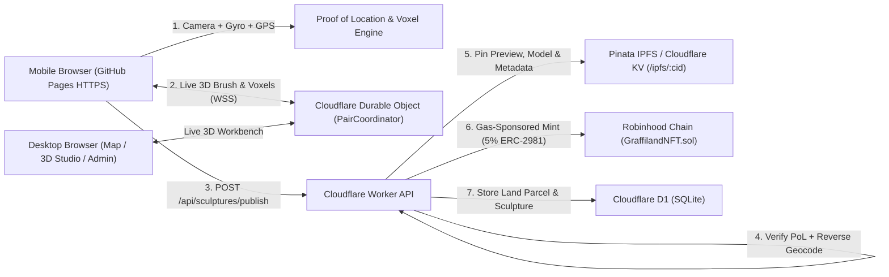

# GRAFFILAND — Location-Bound 3D Voxel Graffiti & Virtual Land

> Turn the physical world into a shared 3D voxel canvas. Wave your phone like a spatial spray-can over a live camera feed, verify you're really standing there using **Camera + GPS Proof of Location**, claim a **Virtual Land** parcel, and mint gas-sponsored 3D NFTs to **IPFS** and **Robinhood Chain** with a **5% resale royalty**.

- **Live App (GitHub Pages)**: https://maximusmaximus.github.io/graffiland/
- **Live Edge API & WebSocket Hub (Cloudflare Workers)**: https://graffiland-api.maxinfeld-artshow.workers.dev

---

## What It Does

GRAFFILAND splits into two purpose-built interfaces depending on the device you open it on:

### 1. Mobile Full-Screen AR Sculpting Studio
Sculpting and publishing **require a mobile device** with a camera, gyroscope, and GPS:
- **Ultra-Minimal `"i"` Canvas**: Opens directly into a full-screen (`100vw × 100dvh`) rear-camera view with a transparent Three.js WebGL layer and only an **`ℹ️` Info & Terms** button plus a compact tool toggle (`🎨`) so the artwork owns the screen.
- **Tap-to-Set Start Surface (`📌`), Fluid Tool Carousel, Hold Eraser (`🧽`), Trash Clear (`🗑️`), & Lock Transform (`✅`)**: Tap anywhere on your rear-camera view (floor, table, wall, scene spot, or existing block face) to lock a glowing 3D Start Surface Ring and aligned grid/shadow plane right onto that real surface — or toggle **Free 3D** mid-air mode at any time from the top-left surface pill (`+ Seed` drops an immediate anchor voxel). Glide smoothly across the centered bottom tool carousel (`Brush → Stack → Erase → Lock & Scale → Preview → Agent Code → Publish`) via fluid multi-step touch swiping (arrow steppers are displayed only on non-touch interfaces), or open the menu (`🎨`) for **hold-to-erase** (`🧽`), **Trash Bin** clear canvas (`🗑️`), and the **Check Mark (`✅`)** lock toggle to scale (`0.25x–2.0x`), rotate, and reposition your entire sculpture via 1-finger drag, 2-finger pinch/twist, or sliders before clicking `✅` again to return to drawing mode. Hold/tap the active tool to sweep continuous, linearly interpolated **4x resolution (`0.05m` grid)** voxel strokes with zero skipping in **matte**, **neon**, or **glass** finishes (up to `4,096` blocks within a **`10,000 × 10,000 × 10,000` block** area per sculpture). Move your phone around as guided by the **bottom-right Scene Coverage Window (`📡`)** until `9/12` view sectors fill (`100% LOCKED`) for optimal scene analysis, GPS/altitude refinement, and precise placement.
- **Tool Readiness & Prerequisite Notifications (`🔒`)**: Across both Mobile AR Studio and Desktop Pair Workbench, tools whose prerequisites aren't met yet (such as Stack/Eraser/Clear/Lock before placing blocks, Foreground Occlusion before camera readiness, or Publish before GPS, space mapping, and Google Sign-In) appear greyed out and display a direct notification explaining what step is needed first when selected.
- **Bottom-Left Public Area Map & Google Maps Navigation (`🗺️` / `🧭`)**: Tap the bottom-left **Map** icon anytime inside the mobile AR studio to view public sculptures and highlighted **Virtual Land parcels (`GH-...`)** in your area (`5km` radius or global view), click any pin, parcel rectangle, or area card to review its interactive **3D voxel model**, inspect its dedicated **Virtual Land Parcel mini-map** and clickable **on-chain transaction (`Tx Hash` / Explorer)**, and tap **Navigate** to open turn-by-turn **Google Maps** directions right to that sculpture's physical coordinates.
- **Face-Snapping Voxel Stacker (`🧱`)**: Raycasts directly from your reticle onto existing voxels in your sculpture, projecting a wireframe ghost block onto the targeted face so you can tap or hold down the Stack button (Key Button or menu) to draw and stack towers, arches, and pixel sculptures continuously.
- **Location AR Preview Mode (`👁️`)**: Queries nearby published (non-hidden) sculptures within `300m` of your GPS fix and projects every phone-made 3D sculpture at its real east/north spatial offset around you so you can walk around street graffiti left at that spot.
- **Copy Agent Sculpture Code (`📋`, Final Tool Before Publish)**: Generate and copy a location-anchored code (`GRF-...`) from your live GPS spot. Any external AI agent (e.g. Grok Bot) can inspect all available 4x grid tools, 12 colors, and block finishes via `/api/agent/spec`, build a 3D voxel draft via `POST /api/agent/sessions/:code/sculpture`, and stream it straight to your phone — while requiring **you** to review in AR and tap Publish on your own mobile device.
- **Auto-Saved Drafts (`💾`)**: All in-progress voxels, title, description, and locked surface anchors automatically save locally (`localStorage`) on every edit and sync to your Google account's cloud drafts (`sculpture_drafts`) via `/api/drafts` so unfinished work is preserved across refreshes or sessions and can be inspected on desktop (`💾 Drafts`) before minting.
- **Gas-Free Publish (`🚀`)**: Sign in with **Google**, add a limited-terms title (`3–48` chars) and description (`10–240` chars, max `45` words), accept the Virtual Land Terms, and publish directly to IPFS + Robinhood Chain. You receive the minted ERC-721 NFT straight in your wallet at zero gas cost.

### 2. Desktop 3D Isometric Explorer & Land Builder (`100dvh`)
Opening GRAFFILAND on desktop opens a **100% full-viewport 3D Isometric Land Studio & explorer**:
- **Real 3D Buildings, Terrain & Dynamic Live Search**: Opens directly in **Isometric 3D view (`52°` tilt, `-45°` bearing)** with real 3D OpenFreeMap buildings, toggleable DEM terrain, smooth **2D / 3D / Isometric** switching, compass rotation (`-15°` / `+15°` / `North`), **Tilt (`0°–65°`)** slider, and live debounced **type-ahead search** (ArcGIS World Geocoder + Photon + Nominatim with proximity/intersection ranking) for street intersections (e.g., `Market & 5th`), nearby businesses, addresses, coordinates, or `GLAND-...` parcels via `/api/geocode/search`.
- **Hover-to-Select & On-Map 3D CAD Gizmo Handles (`✏️ Draw Land` / `🏗️ Mint Land`)**: Click **Draw Land** right on the map toolbar to click-drag 3D wireframe plots aligned with the exact camera/building orientation (auto-exiting draw mode after placing a plot so you cannot accidentally draw across multiple locations). Hover over any unminted land to select it and manipulate it directly on canvas: drag glowing **corner balls** to scale (up to `5,000 m²` / `120m`), drag **side segment bars** to stretch individual edges, hold & drag **vertical gold corner bars** to rotate (`0°–359°`), drag the **top bar** to scale Z-height (`4–250m`, max `500,000 m³`), or drag the **center** to reposition. Distinct glowing wireframes distinguish **Cyan** (considering), **Gold/Amber** (owned), **Magenta** (agent quests), and **Crimson** (overlaps/limits). Copy per-parcel deep links, mint starter plots (`3` free gas-sponsored human starter claims), or click **Copy All Properties for Agent**.
- **Clean One-Sentence Intro Banner, Clickable `"i"` Tooltips & Viewport-Organized Guide**: Concise plain-English intro banner with on-demand clickable `"i"` tooltips across controls, plus a streamlined Guide menu organized cleanly by **Desktop Map & 3D Land** vs **Mobile AR Studio**.

---

## How It Works Under the Hood



### 1. Camera + GPS Proof of Location (Anti-Spoof Presence)
Instead of trusting raw GPS coordinates alone (which can be mocked), GRAFFILAND captures multi-sensor evidence during the sculpting session via [`ProofOfLocationTracker`](client/src/components/ProofOfLocation.js) and verifies it in [`verifyAndEnrichLocation`](server/services/pol.mjs):

1. **Camera-Gyro Optical-Flow Correlation**: Every `450ms`, the client samples a downsampled `48×36` frame from the live camera stream and measures horizontal image displacement (`SAD` shift match) against simultaneous `DeviceOrientationEvent` yaw deltas (`Δalpha`). Physically panning a phone through real space produces correlated image motion; static photos or GPS spoofers without real camera parallax score poorly.
2. **Astronomical Solar vs. Horizon Luminance Check**: Using `(lat, lng, UTC timestamp)`, the backend computes the sun's expected altitude angle (`daylight`, `twilight`, or `night`) and compares it against the upper-horizon brightness of the live camera feed.
3. **GPS Trajectory Sanity**: Tracks rolling GPS fixes throughout the sculpting session and rejects impossible teleport speeds (`>= 60 m/s` between samples).
4. **Environmental Fingerprint**: Extracts a 5-color ambient scene palette and a 64-bit perceptual `visualDHash` (preserving street privacy while binding the visual atmosphere to the proof).
5. **Cryptographic Commitment**: Combines all sensor, reverse-geocoded Nominatim address, solar, and timestamp fields into a `0–100` PoL score and `keccak256` `proofHash` embedded in both IPFS metadata and the Robinhood Chain NFT contract.

### 2. Geohash Virtual Land Parcels
Every `(lat, lng)` coordinate encodes into an **8-character Geohash** (e.g., `GLAND-9Q8YYK8D`), partitioning Earth into ~12m × 12m spatial cells.
- Publishing a sculpture binds the NFT to that `landParcelId` on-chain (`bytes32`), tracks the parcel claimant history in D1 (`land_parcels`), and renders the exact decoded bounding box rectangle on the desktop map.

### 3. Google Sign-In, Portable Wallets & Marketplace-Ready Robinhood NFTs
- **Google-Only Auth**: Users sign in via Google Identity Services (`GOOGLE_CLIENT_ID`, with an optional local dev fallback when unset).
- **Zero-Friction Custodial & Self-Custody Wallets**: On first sign-in, the backend generates an EVM wallet encrypted with **AES-256-GCM** (`WALLET_ENCRYPTION_KEY`) per Google account. Users can mint directly to a custom payout EVM wallet, export their private key, **import into MetaMask (`wallet_watchAsset`)**, or **transfer** any sculpture NFT (`POST /api/sculptures/:id/transfer`) to any external `0x...` wallet or marketplace.
- **Standard ERC-721 + 3D `.glb` + 5% Resale Royalty ([GraffilandNFT.sol](contracts/GraffilandNFT.sol))**:
  - Inherits OpenZeppelin `ERC721`, `ERC721Enumerable`, `ERC721URIStorage` (**IERC-4906** metadata updates), `ERC721Royalty` (**ERC-2981**), `Ownable`, and **EIP-7572** `contractURI()` collection metadata (`/api/contract/metadata.json`).
  - Exports every voxel sculpture as a standard **glTF 2.0 binary (`.glb`)** model (`/api/sculptures/:id/model.glb` + pinned to IPFS as `animation_url` in ERC-721 metadata at `/api/sculptures/:id/metadata.json` & `/api/tokens/:tokenId.json`) so sculptures render interactively on OpenSea, Rarible, Blockscout, MetaMask, and 3D viewers.
  - Enforces `RESALE_FEE_BPS = 500` (**5.00%**) across default and per-token `royaltyInfo`, plus live `ownerOf(tokenId)` **ownership sync** (`POST /api/sculptures/:id/sync-ownership`) so secondary marketplace sales reflect immediately.

### 4. Elevation Anchoring, Occlusion, Reflections & Real Shadows
- **Elevation & Altitude Lock (`shared/sculpture.mjs`, `server/services/pol.mjs`)**: Captures browser GPS `altitude` + `altitudeAccuracy`, cross-checks terrain elevation to compute height above ground (`AGL`), and records vertical voxel bounds (`sculptureVerticalMinM..MaxM`) in IPFS metadata so sky-high or multi-story sculptures stay locked to their vertical level in AR Preview.
- **Visible Origin Lock, Occlusion & Origin-Blocked Guard (`ForegroundOcclusion.js`)**: Renders an enhanced 3D sculpture origin ring & footprint beacon behind a background-aware `128×96` gyro-compensated occlusion layer (`z-index: 4`) so moving or stationary objects in front hide occluded sculpture segments cleanly and block starting new paint strokes with an immediate `"Origin is blocked"` alert until cleared.
- **Live Grayscale Unmapped Preview & Mapping Completion (`ProofOfLocation.js`, `MobileStudio.jsx`)**: Renders unmapped angular regions of your live camera feed as a real-time grayscale veil (`8×6` viewport grid mapped to `16×12` angular coverage) that turns full-color as you sweep, plus grayscale vs. color tiles inside the bottom-right Scene Coverage Window, announcing **"Mapping complete for this space!"** once optimal coverage (`100%`) is reached.
- **Live Location Reflections & Solar Shadows (`VoxelEngine3D.js`, `MobileStudio.jsx`)**: Generates equirectangular `PMREMGenerator` environment maps from the live camera feed (`256×128` off-stroke refresh, `PBR` clearcoat glass, metallic neon, matte reflections) paired with astronomical solar-azimuth directional lights and invisible `ShadowMaterial` shadow catchers aligned to your selected start surface.
- **Hybrid WebXR + Non-Reversible 3-Angle ORB Landmark Anchoring (`orbWorker.js`, `orbTracker.js`, `shared/landmarkService.mjs`)**: During mobile Scene Scan, a zero-dependency Web Worker extracts rotated FAST + rBRIEF-256 descriptors across 3 viewing angles (left / center / right) without retaining or uploading raw pixels. Landmark packs are stored on IPFS (`POST /api/lands/:parcelId/landmark-pack`) and strictly geofenced to mobile visitors within `<= 65m` (`/landmark-pack/fetch`), enabling smooth AR relocalization across both Android WebXR and iOS Safari plus live RANSAC inlier proofs when unlocking strict parcels.
- **Ground AR Parcel Borders, Spatial Streaming & Draco/Meshopt 3D Assets (`shared/model3d.mjs`, `customModelLoader.js`)**: Map views stream lightweight metadata (`?includeVoxels=0`) while Mobile AR progressively hydrates full 3D geometry within `65m` and draws each parcel's rectangular boundary on the ground (cyan outside, pulsing gold inside). Non-voxel 3D assets support bundled local **Draco** and **Meshopt** decoders, enforce mobile-safe `150,000` triangle / `8` texture budgets, support fine `anchorOffset` (`dx, dy, dz, yaw`), and ship in code-split React + Three.js chunks (`vite.config.js`).
- **PIN_MASTER_KEK, Hardware WebAuthn Passkeys, Immutable Revisions & `ERC-4906` (`shared/passkeyService.mjs`, `GraffilandNFT.sol`)**: Parcel pin seal secrets are envelope-encrypted under `PIN_MASTER_KEK` (`kek-v1`), landholders can toggle per-parcel **Hardware ES256 Passkey (WebAuthn)** + **ORB PnP** requirements inside **Manage Lands**, every edit creates an immutable `sculpture_revisions` record protected by optimistic `expectedRev` (`409` on conflict) with 1-click Land Holder rollback and `ERC-4906` `updateTokenURI` / `MetadataUpdate` emission, and chain mutations enforce daily sponsored-relayer gas quotas (`relayer_usage`).

### 5. Camera-Locked Encrypted Location Chat & Parcel-Pinned IPFS Batches
- **Glowing Selectable AR Bases & Instant Chatbox Entry**: In mobile AR Preview (`MobileStudio.jsx`), nearby sculptures display a pulsing glowing base ring on the ground (cyan idle, gold when targeted). Visitors can tap a sculpture or its glowing base to immediately preview its **Title**, **Description**, and decrypted **Pinned Messages** and join its chatbox.
- **Parcel-Locked Pinned IPFS Messages (`shared/pinService.mjs`)**: Verified Land Holders can pin, edit, alter, or remove batches of pinned messages stored strictly as client-side `AES-256-GCM` ciphertext batches pinned to **IPFS** (`POST /api/sculptures/:id/pins/batch`, incremented monotonically per edit). Plaintext never touches SQLite, D1, IPFS, or public API responses. Only a physical mobile visitor inside that exact **Geohash-8 Virtual Land parcel** who passes single-use `ECDSA P-256` challenge signing, live camera frame + perceptual `visualDHash`, gyroscope optical-flow correlation, and anti-teleport GPS validation (`POST /api/sculptures/:id/pins/unlock`) can decrypt the IPFS pin batch.
- **Camera-Only Admission (`shared/chatPolicy.mjs`)**: Chat boards only open when viewing a sculpture in person on a mobile device (`<= 75m`, altitude-matched, live camera frames) and directly selecting its 3D voxels or glowing base inside the AR camera viewport via `THREE.Raycaster`. Desktop visitors see only locked post counts (`🔒`).
- **True Zero-Server-Knowledge (`client/src/utils/chatCrypto.js`)**: Messages are encrypted client-side using a 256-bit `AES-256-GCM` room key (`K_room`) bound with `ECDSA P-256` signatures and AAD integrity checks. Database tables hold **zero plaintext** and **zero room keys**.
- **Hybrid Key Distribution**: Creators and admitted visitors automatically wrap `K_room` to incoming physical viewers via ephemeral **`ECDH P-256` + `HKDF-SHA256`**, plus an optional creator **On-Site Visual Clue (`PBKDF2-SHA256`, 210k iterations)** for 24/7 solo unlocking without exposing clue answers to the server.
- Read the full cryptographic specification in [`docs/ENCRYPTED_LOCATION_CHAT.md`](docs/ENCRYPTED_LOCATION_CHAT.md).

### 6. Agentic-First Virtual Land Protocol, Stdio MCP, Plinth Quests & 5%/3%/2% Splits
- **Zero-OAuth Autonomous Agent Onboarding ([`docs/AGENTIC_ARCHITECTURE_PROPOSAL.md`](docs/AGENTIC_ARCHITECTURE_PROPOSAL.md), [`/llms.txt`](https://graffiland-api.maxinfeld-artshow.workers.dev/llms.txt), [`/.well-known/agent.json`](https://graffiland-api.maxinfeld-artshow.workers.dev/.well-known/agent.json))**:
  - Autonomous AI agents authenticate via pure EIP-191 wallet challenge (`/api/agents/challenge` -> `/api/agents/register`) with **zero Google OAuth or browser pairing required**.
  - **Local Stdio MCP Server (`npx graffiland-mcp`) & CLI (`npx graffiland`)**: Set `GRAFFILAND_PRIVATE_KEY` and `GRAFFILAND_API_URL` in Claude Desktop, Cursor, OpenClaw, or LangGraph to invoke `agent_profile`, `scout_lands`, `claim_land`, `generate_voxel_prefab` (`plinth`, `arch`, `totem`, `pyramid`, `beacon`), `batch_build_land`, `create_art_quest`, and `get_land_telemetry` over standard MCP stdio.
  - **Fair Cost & Anti-Squatting Design (3 Slots · 7-Day Lease)**: Every AI agent gets **3 free land claims** (`0` platform fee — **AI agents pay their own chain network gas**, while IRL mobile human creators publish gas-free). Unawakened parcels return to open supply after **7 days (168h)**.
  - **Awakening Rush & Plinth Snapping**: When a mobile human visits an agent's parcel in person and sculpts **>= 3 blocks** (or a valid 3D model) onto a Quest plinth, the land awakens forever, earns **2x First-Spark XP** (`300 XP`) + bounties, and unlocks **+2 more land slots** (up to 50) for the agent.
  - **Simple 5% / 3% / 2% Royalty Split (`GraffilandRoyaltyRouter.sol` & `GraffilandMarketplace.sol`)**: Every Marketplace trade and Quest bounty splits automatically:
    - **5% (`500 bps`) -> Platform**
    - **3% (`300 bps`) -> Agent Land Steward**
    - **2% (`200 bps`) -> Human Creators Pool** (shared pro-rata among verified IRL builders on that land)
    - **90% (`9000 bps`) -> Net Seller**

### 7. Agent Sculpture Staging, Land MCP Service & Two-Way Signing (`📋` / `🔗`)
- **4x High-Density Sculptures (`shared/constants.mjs`)**: Voxel grid resolution is `0.05m` (`4x` sharper than `0.2m`, supporting up to `4,096` blocks via O(1) incremental mesh diffing and interpolated brush batches) inside a strict `10,000 × 10,000 × 10,000` block area cap (`±250m`), backed by `1920×1080` live camera capture, `256×128` reflection cubemaps, `128×96` ghost-free foreground occlusion, `1024×1024` shadow maps, and mobile-optimized DPR (`<= 2`) rendering.
- **Location-Anchored Agent Handoff (`shared/agentService.mjs`)**: Selecting **Agent Code (`📋`)** creates an expiring `GRF-...` session anchored to your GPS coordinates (`POST /api/agent/sessions`) so external AI agents can build and stage geometry (`POST /api/agent/sessions/:code/sculpture`) for your mobile AR review.
- **Property Ownership Editing, Non-Voxel 3D Models, Contributors & Active-Pairing MCP (`shared/mcpService.mjs`, `shared/model3d.mjs`, `shared/landSignatureMessage.mjs`)**:
  - **Land Management Dashboard (`🗺️ Land`)**: Immediately after a user publishes their first sculpture/land, a **Land Management** button appears directly on the main AR canvas (and Desktop header), letting owners manage curations, toggle Contributor & Agent Erase settings, inspect non-voxel 3D models, and erase lands post-publish.
  - **Any Suitable 3D Model on Land (Even Non-Voxel Files)**: Connected MCP agents can load `.glb`, `.gltf`, `.obj`, `.stl`, and `.ply` files onto owned land (`load_3d_model_on_land` / `put_sculpture_on_land` / `update_land_sculpture`), validated by `shared/model3d.mjs`, pinned to IPFS, served from `/api/sculptures/:id/model`, and rendered in 3D/AR viewers (`client/src/utils/customModelLoader.js`).
  - **Authorized Land Erasure via Agent**: Agents can erase an existing owned parcel (`erase_land`) ONLY when both the parcel's `allowAgentErase` permission is enabled AND the landholder provides an EIP-191 signature or mobile `Sign & Approve` confirmation.
  - **IRL Visitor Contributors**: Land holders can add **Contributor accounts** restricted server-side strictly to users who visited that exact parcel and interacted/chatted on it in real life (`POST /api/lands/:parcelId/contributors`), allowing those contributors to modify sculptures on the parcel (inline or right on the 3D AR canvas).
  - **Strict MCP Activation Gate & Two-Way Signing**: MCP stays inactive (`403`) until a robust `GLP-XXXX-XXXX-XXXX-XXXX` pairing code is connected (`POST /api/mcp/pairings/connect`). When paired keys are connected during mobile publish, users choose **Sign & Publish on Mobile** or **Copy Agent Sign & Publish Prompt**.

---

## 🤖 Copyable Property Owner Agent & MCP Prompt

If you hold Virtual Land property (at least one published sculpture on a `GLAND-...` parcel), copy the entire prompt below into your AI agent after generating your robust **`GLP-XXXX-XXXX-XXXX-XXXX`** pairing code in Mobile Studio or Desktop QR Pair:

```markdown
You are connected as my GRAFFILAND Property Agent. I own Virtual Land parcel(s) and sculptures on GRAFFILAND (`https://graffiland-api.maxinfeld-artshow.workers.dev`).

My Session Credentials (fill in before sending):
- API Base URL: `https://graffiland-api.maxinfeld-artshow.workers.dev`
- Robust Pairing Code (`GLP-...`): `<PASTE_YOUR_GLP_PAIRING_CODE>`
- Property Owner Wallet (`0x...`): `<PASTE_YOUR_OWNER_WALLET_ADDRESS>`
- (Optional, only if running agent-side signing): Owner Private Key held locally by agent for EIP-191 `wallet.signMessage(...)`

Follow these rules & capabilities strictly:

1. **Activate MCP Service First (Required Gate)**
   MCP is inactive for my account until my robust pairing code is connected.
   - `POST {API_BASE}/api/mcp/pairings/connect`
   - Body: `{ "pairingCode": "<GLP_CODE>", "agentName": "my-property-agent", "agentAddress": "<OWNER_WALLET>" }`
   - If you hold my owner private key locally, also sign the returned `handshakeMessage` with `wallet.signMessage(handshakeMessage)` and submit `{ "pairingCode", "signature" }` to verify live two-way key custody (`keyConnected: true`).
   - Include header `X-Graffiland-Pairing-Code: <GLP_CODE>` on all MCP calls (`POST {API_BASE}/api/mcp`).

2. **Discover Tools & Read Specs**
   - `POST {API_BASE}/api/mcp` with `{ "jsonrpc": "2.0", "id": 1, "method": "tools/list", "params": {} }`
   - Call `get_spec` (or `GET {API_BASE}/api/agent/spec`) for exact 4x resolution (`0.05m` voxel step), 12 hex colors, 3 finishes (`matte`, `neon`, `glass`), max `4,096` blocks, `10000x10000x10000` area limits, and Limited Terms rules.

3. **Inspect All Property & Sculptures You Manage**
   - Call MCP `list_my_lands` to list all Virtual Land parcels (`GLAND-...`) and sculptures I own.
   - Call MCP `get_land` with `{ "parcelId": "GLAND-..." }` to inspect full voxel arrays, land curations, bounds, and chain Tx hashes.
   - Call `list_pending_signatures` to inspect any pending publish or property requests waiting for a signature.

4. **Edit Land, Load Any 3D Model, Curate Parcels & Erase Land (Property Owner Permissions)**
   Because I hold property on these parcels, use MCP tools cleanly:
   - Put a new voxel sculpture onto my owned parcel: `put_sculpture_on_land` `{ parcelId, title, description, voxels, lat?, lng?, signature? }`
   - Load ANY suitable non-voxel 3D model (`.glb`, `.gltf`, `.obj`, `.stl`, `.ply`) onto my owned parcel: `load_3d_model_on_land` `{ parcelId, title, description, modelFormat, modelBase64? | modelData? | modelUrl?, modelScale?, sculptureId?, signature? }`
   - Update any owned sculpture or 3D model on the land: `update_land_sculpture` `{ sculptureId, title?, description?, voxels?, modelFormat?, modelBase64?, modelData?, modelUrl?, signature? }`
   - Curate my land parcel: `update_land_parcel` `{ parcelId, customName?, curationNote?, featuredSculptureId?, signature? }`
   - Remove an owned sculpture: `delete_land_sculpture` `{ sculptureId, signature? }`
   - Erase an existing owned land (ONLY when enabled by the landholder via `allowAgentErase`): `erase_land` `{ parcelId, confirmParcelId, reason?, signature? }`
   - Pin / update / alter parcel-locked encrypted IPFS messages for real-life visitors inside `sculpture.parcelId` (via client-side AES-256-GCM `encryptPinnedIpfsBatch` + `POST {API_BASE}/api/sculptures/{id}/pins/owner-seal` & `POST {API_BASE}/api/sculptures/{id}/pins/batch`).

5. **Two-Way Signing & Mobile Signature Notifications**
   - **If you hold my private key locally**: sign `canonicalMessage` via EIP-191 (`wallet.signMessage(canonicalMessage)`) and call `sign_and_execute_pending` (`{ requestId, signature, txHash? }`) or `POST {API_BASE}/api/signatures/requests/{requestId}/agent-sign` to execute from the agent side.
   - **If you do NOT hold my private key**: call the MCP mutation tool without `signature` — GRAFFILAND automatically sends a real-time signature notification to my mobile phone so I can review and tap **Sign & Approve**.

6. **Sign & Publish on My Behalf When Prompted From Mobile**
   When I tap **Copy Agent Sign & Publish Prompt** on mobile during publishing, I will give you a `requestId` and `canonicalMessage` (already verified with live Mobile Camera + GPS Proof of Location). Sign `canonicalMessage` with my key and submit via `sign_and_execute_pending` or `POST {API_BASE}/api/signatures/requests/{requestId}/agent-sign` to finalize IPFS pinning & minting to my wallet.

7. **Additional Application Features Available to Property Holders**
   - Export 3D glTF `.glb` (`GET {API_BASE}/api/sculptures/{id}/model.glb`) and ERC-721 metadata (`GET {API_BASE}/api/sculptures/{id}/metadata.json`)
   - Transfer NFTs (`POST {API_BASE}/api/sculptures/{id}/transfer`) and sync on-chain marketplace ownership (`POST {API_BASE}/api/sculptures/{id}/sync-ownership`)
   - Stage pre-publish drafts to mobile (`POST {API_BASE}/api/agent/sessions/{GRF_CODE}/sculpture`)
   - Respect AR Location Chat boundaries (E2EE room keys stay client-side in physical mobile AR view only) and Limited Terms policy.
```

### 7. Xero Emoji UI System
Every icon across mobile HUD triggers, map pins, desktop tabs, and modals is rendered using [`xeroemoji`](https://github.com/maximusmaximus/xeroemoji) via [`XeroIcon.jsx`](client/src/components/XeroIcon.jsx) (with automatic PNG and glyph fallback).

---

## Repository Structure

| Path | Purpose |
| :--- | :--- |
| `client/` | React + Three.js + Leaflet + Vite frontend (`MobileStudio` orchestrator + `hooks/*` + `studio/*` subcomponents, `DesktopHub`, `MapView`, `PairWorkbench3D`, `LandManagementModal`, `AdminPanel`, `SceneErrorBoundary`) |
| `worker/` | Cloudflare Worker API, D1 schema (`schema.sql`), WebCrypto JWT/AES (`crypto.js`), and `PairCoordinator` Durable Object with persisted DO state |
| `server/` | Standalone Node/Express + `node:sqlite` + WebSocket server for local HTTPS development |
| `shared/` | Modular domain services (`mcp/*` split from `mcpService.mjs`, `monitoringService.mjs`, `landmarkService.mjs`, `passkeyService.mjs`, `pinService.mjs`, `types.d.ts`) |
| `contracts/` | `GraffilandNFT.sol` (ERC-721 + 5% ERC-2981 royalty + ERC-4906) plus `solc`/`ethers` compile & deploy scripts |
| `tests/` | Backend integration (`tests/graffiland.test.mjs`), React Testing Library UI unit tests (`tests/ui.test.mjs`), and headless Chrome Playwright E2E (`tests/e2e.playwright.mjs`) |

---

## Security Threat Model, Performance & Operational Readiness

- **Proof of Location Threat Model**: GRAFFILAND fuses live rear-camera frames, optical-flow correlation, gyroscope motion, GPS/geohash proximity, **server-verified binary ORB Hamming matching** (`matchedDescriptors` against parcel `landmark_anchors`), and optional hardware **ES256 WebAuthn Passkeys**. Because web browsers supply client sensor streams, a determined attacker with a virtual camera + simulated GPS/gyro could spoof weak checks on public parcels; high-value parcels should require strict **ORB + Passkey unlock** policies.
- **Takedown & Virtual Land Dispute Resolution**: Prohibited content, physical-safety hazards, and verified IP complaints can be immediately suppressed from public feeds via Admin visibility controls with audit reasons while preserving immutable on-chain ERC-721 history. First-valid PoL claims win initial Virtual Land parcel anchoring.
- **3D Rendering & Mobile AR Quality**: Voxel sculptures batch via `THREE.InstancedMesh` per color/material bucket with `>25m` distance LOD simplification, WebGL `webglcontextlost` recovery + `SceneErrorBoundary`, smoothed visual ORB heading yaw correction in Preview, and a manual touch-drag fallback when iOS/Android gyroscope permissions are unavailable or denied.
- **Rate Limiting, Telemetry & Hygiene**: API publish, land-create, and MCP routes enforce sliding-window DB rate limiting (`api_rate_limits`), relayer quotas refund automatically on failed mints, `ops_events` feeds `/api/admin/metrics` alerts, `ALLOW_DEV_GOOGLE_AUTH` is disabled in production Wrangler config, and CI runs `npm test`, `npm run lint`, `npm run typecheck`, `npm run build`, and `npm run contract:compile` (see `.github/workflows/ci.yml` / `deploy/ci-workflow.yml`).

---

## Secret Keys & Security Model

Because this repository is public, **private keys and API secrets are never committed to git**. Instead:
- **Cloudflare Worker Secrets** hold runtime secrets (`SESSION_SECRET`, `WALLET_ENCRYPTION_KEY`, `ADMIN_EMAILS`, and optional `PINATA_JWT`, `GOOGLE_CLIENT_ID`, `ROBINHOOD_RELAYER_PRIVATE_KEY`, `ROBINHOOD_CONTRACT_ADDRESS`).
- **GitHub Repository Secrets / Variables** mirror deployment settings without exposing them in source files.

To configure production Google OAuth, Pinata IPFS, or live Robinhood Chain minting on the Worker:
```bash
npx wrangler secret put GOOGLE_CLIENT_ID --config worker/wrangler.toml
npx wrangler secret put PINATA_JWT --config worker/wrangler.toml
npx wrangler secret put ROBINHOOD_RELAYER_PRIVATE_KEY --config worker/wrangler.toml
npx wrangler secret put ROBINHOOD_CONTRACT_ADDRESS --config worker/wrangler.toml
```

---

## Local Development & Deployment

1. **Install & Run Locally (HTTPS + WSS for Wi-Fi mobile testing)**:
   ```bash
   cp .env.example .env
   npm install
   npm run dev
   ```
   Open `https://localhost:5173` on desktop or `https://<your-lan-ip>:5173` on mobile.

2. **Deploy Updates**:
   ```bash
   # Deploy frontend bundle to GitHub Pages
   npm run deploy:pages

   # Apply D1 schema & deploy Cloudflare Worker + Durable Object
   npm run deploy:worker:db
   npm run deploy:worker

   # Compile & deploy GraffilandNFT.sol to Robinhood Chain Testnet (46630) or Mainnet (4663)
   npm run contract:compile
   npm run contract:deploy
   ```

3. **Run Tests, Lint, Typecheck & E2E**:
   ```bash
   npm test
   npm run lint
   npm run typecheck
   npm run build
   npm run test:e2e
   ```

---

## Credits
- Icons: **Xero Emoji** by Max Infeld (`xeroemoji`, CC BY 4.0)
