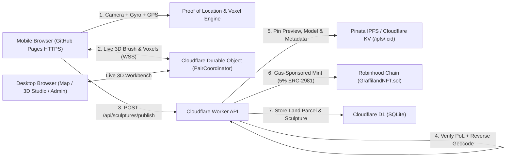

# GRAFFILAND — Location-Bound 3D Voxel Graffiti & Virtual Land

> Turn the physical world into a shared 3D voxel canvas. Wave your phone like a spatial spray-can over a live camera feed, verify you're really standing there using **Camera + GPS Proof of Location**, claim a **Virtual Land** parcel, and mint gas-sponsored 3D NFTs to **IPFS** and **Robinhood Chain** with a **5% resale royalty**.

- **Live App (GitHub Pages)**: https://maximusmaximus.github.io/graffiland/
- **Live Edge API & WebSocket Hub (Cloudflare Workers)**: https://graffiland-api.maxinfeld-artshow.workers.dev

---

## What It Does

GRAFFILAND splits into two purpose-built interfaces depending on the device you open it on:

### 1. Mobile Full-Screen AR Sculpting Studio
Sculpting and publishing **require a mobile device** with a camera, gyroscope, and GPS:
- **Ultra-Minimal `"i"` Canvas**: Opens directly into a full-screen (`100vw × 100dvh`) rear-camera view with a transparent Three.js WebGL layer and only an **`ℹ️` Info & Terms** button plus a compact tool toggle (`🎨`) so the artwork owns the screen.
- **Phone-as-a-3D-Brush (`🖌️`)**: Hold the paint trigger and sweep your phone in mid-air. Your gyroscope steers a `0.2m`-grid 3D cursor in front of you, extruding continuous voxel strokes in **matte**, **neon**, or **glass** finishes (up to `512` voxels per sculpture).
- **Face-Snapping Voxel Stacker (`🧱`)**: Raycasts directly from your reticle onto existing voxels in your sculpture, projecting a wireframe ghost block onto the targeted face so you can stack towers, arches, and pixel sculptures block-by-block.
- **Location AR Preview Mode (`👁️`)**: Queries nearby published (non-hidden) sculptures within `300m` of your GPS fix and projects every phone-made 3D sculpture at its real east/north spatial offset around you so you can walk around street graffiti left at that spot.
- **Gas-Free Publish (`🚀`)**: Sign in with **Google**, add a limited-terms title (`3–48` chars) and description (`10–240` chars, max `45` words), accept the Virtual Land Terms, and publish directly to IPFS + Robinhood Chain. You receive the minted ERC-721 NFT straight in your wallet at zero gas cost.

### 2. Desktop Explorer, Map, 3D Pair Studio & Admin
Opening GRAFFILAND on desktop launches the multi-tab hub:
- **Global Map View (`🗺️`)**: Dark-mode OpenStreetMap Leaflet map rendering glowing **Geohash-8 Virtual Land parcel polygons** and clickable sculpture pins with full 3D orbit inspection and location/PoL/on-chain metadata.
- **Contributions Gallery (`🧱`)**: Filterable 3D card grid with interactive Three.js `OrbitControls` previews of every visible sculpture.
- **Live 3D Pair Studio (`🔗`)**: Generates a QR code and 6-character pairing code over WebSockets (`/ws`). Scan it with your phone to turn the phone into a wireless 3D gyro brush while watching the entire sculpture build in real time on your desktop monitor—complete with remote desktop brush, color, undo, recenter, preview, and publish triggers.
- **Admin Moderation Panel (`🛡️`)**: Restricted to authorized Google Admin accounts (`ADMIN_EMAILS`) to inspect Proof-of-Location telemetry and **hide/unhide** items across the public map, gallery, and mobile AR preview feeds.

---

## How It Works Under the Hood



### 1. Camera + GPS Proof of Location (Anti-Spoof Presence)
Instead of trusting raw GPS coordinates alone (which can be mocked), GRAFFILAND captures multi-sensor evidence during the sculpting session via [`ProofOfLocationTracker`](client/src/components/ProofOfLocation.js) and verifies it in [`verifyAndEnrichLocation`](server/services/pol.mjs):

1. **Camera-Gyro Optical-Flow Correlation**: Every `450ms`, the client samples a downsampled `48×36` frame from the live camera stream and measures horizontal image displacement (`SAD` shift match) against simultaneous `DeviceOrientationEvent` yaw deltas (`Δalpha`). Physically panning a phone through real space produces correlated image motion; static photos or GPS spoofers without real camera parallax score poorly.
2. **Astronomical Solar vs. Horizon Luminance Check**: Using `(lat, lng, UTC timestamp)`, the backend computes the sun's expected altitude angle (`daylight`, `twilight`, or `night`) and compares it against the upper-horizon brightness of the live camera feed.
3. **GPS Trajectory Sanity**: Tracks rolling GPS fixes throughout the sculpting session and rejects impossible teleport speeds (`>= 60 m/s` between samples).
4. **Environmental Fingerprint**: Extracts a 5-color ambient scene palette and a 64-bit perceptual `visualDHash` (preserving street privacy while binding the visual atmosphere to the proof).
5. **Cryptographic Commitment**: Combines all sensor, reverse-geocoded Nominatim address, solar, and timestamp fields into a `0–100` PoL score and `keccak256` `proofHash` embedded in both IPFS metadata and the Robinhood Chain NFT contract.

### 2. Geohash Virtual Land Parcels
Every `(lat, lng)` coordinate encodes into an **8-character Geohash** (e.g., `GLAND-9Q8YYK8D`), partitioning Earth into ~12m × 12m spatial cells.
- Publishing a sculpture binds the NFT to that `landParcelId` on-chain (`bytes32`), tracks the parcel claimant history in D1 (`land_parcels`), and renders the exact decoded bounding box rectangle on the desktop map.

### 3. Google Sign-In, Portable Wallets & Marketplace-Ready Robinhood NFTs
- **Google-Only Auth**: Users sign in via Google Identity Services (`GOOGLE_CLIENT_ID`, with an optional local dev fallback when unset).
- **Zero-Friction Custodial & Self-Custody Wallets**: On first sign-in, the backend generates an EVM wallet encrypted with **AES-256-GCM** (`WALLET_ENCRYPTION_KEY`) per Google account. Users can mint directly to a custom payout EVM wallet, export their private key, **import into MetaMask (`wallet_watchAsset`)**, or **transfer** any sculpture NFT (`POST /api/sculptures/:id/transfer`) to any external `0x...` wallet or marketplace.
- **Standard ERC-721 + 3D `.glb` + 5% Resale Royalty ([GraffilandNFT.sol](contracts/GraffilandNFT.sol))**:
  - Inherits OpenZeppelin `ERC721`, `ERC721Enumerable`, `ERC721URIStorage` (**IERC-4906** metadata updates), `ERC721Royalty` (**ERC-2981**), `Ownable`, and **EIP-7572** `contractURI()` collection metadata (`/api/contract/metadata.json`).
  - Exports every voxel sculpture as a standard **glTF 2.0 binary (`.glb`)** model (`/api/sculptures/:id/model.glb` + pinned to IPFS as `animation_url` in ERC-721 metadata at `/api/sculptures/:id/metadata.json` & `/api/tokens/:tokenId.json`) so sculptures render interactively on OpenSea, Rarible, Blockscout, MetaMask, and 3D viewers.
  - Enforces `RESALE_FEE_BPS = 500` (**5.00%**) across default and per-token `royaltyInfo`, plus live `ownerOf(tokenId)` **ownership sync** (`POST /api/sculptures/:id/sync-ownership`) so secondary marketplace sales reflect immediately.

### 4. Elevation Anchoring, Occlusion, Reflections & Real Shadows
- **Elevation & Altitude Lock (`shared/sculpture.mjs`, `server/services/pol.mjs`)**: Captures browser GPS `altitude` + `altitudeAccuracy`, cross-checks terrain elevation to compute height above ground (`AGL`), and records vertical voxel bounds (`sculptureVerticalMinM..MaxM`) in IPFS metadata so sky-high or multi-story sculptures stay locked to their vertical level in AR Preview.
- **Foreground Occlusion (`ForegroundOcclusion.js`)**: Uses gyro-compensated optical residual masking on mobile cameras so hands and real objects passing in front of the lens naturally occlude anchored sculptures.
- **Live Location Reflections & Solar Shadows (`VoxelEngine3D.js`, `MobileStudio.jsx`)**: Generates equirectangular `PMREMGenerator` environment maps from the live camera feed (`PBR` clearcoat glass, metallic neon, matte reflections) paired with astronomical solar-azimuth directional lights and invisible `ShadowMaterial` shadow catchers.

### 5. Camera-Locked Encrypted Location Chat (Server-Blind E2EE)
- **Camera-Only Admission (`shared/chatPolicy.mjs`)**: Chat boards only open when viewing a sculpture in person on a mobile device (`<= 75m`, altitude-matched, live camera frames) and directly selecting its 3D voxels inside the AR camera viewport via `THREE.Raycaster`. Desktop visitors see only locked post counts (`🔒`).
- **True Zero-Server-Knowledge (`client/src/utils/chatCrypto.js`)**: Messages are encrypted client-side using a 256-bit `AES-256-GCM` room key (`K_room`) bound with `ECDSA P-256` signatures and AAD integrity checks. Database tables hold **zero plaintext** and **zero room keys**.
- **Hybrid Key Distribution**: Creators and admitted visitors automatically wrap `K_room` to incoming physical viewers via ephemeral **`ECDH P-256` + `HKDF-SHA256`**, plus an optional creator **On-Site Visual Clue (`PBKDF2-SHA256`, 210k iterations)** for 24/7 solo unlocking without exposing clue answers to the server.
- Read the full cryptographic specification in [`docs/ENCRYPTED_LOCATION_CHAT.md`](docs/ENCRYPTED_LOCATION_CHAT.md).

### 6. Xero Emoji UI System
Every icon across mobile HUD triggers, map pins, desktop tabs, and modals is rendered using [`xeroemoji`](https://github.com/maximusmaximus/xeroemoji) via [`XeroIcon.jsx`](client/src/components/XeroIcon.jsx) (with automatic PNG and glyph fallback).

---

## Repository Structure

| Path | Purpose |
| :--- | :--- |
| `client/` | React + Three.js + Leaflet + Vite frontend (`MobileStudio`, `DesktopHub`, `MapView`, `PairWorkbench3D`, `AdminPanel`) |
| `worker/` | Cloudflare Worker API, D1 schema (`schema.sql`), WebCrypto JWT/AES (`crypto.js`), and `PairCoordinator` Durable Object |
| `server/` | Standalone Node/Express + `node:sqlite` + WebSocket server for local HTTPS development |
| `shared/` | Shared constants, Robinhood Chain configs, and Limited Terms moderation policy |
| `contracts/` | `GraffilandNFT.sol` (ERC-721 + 5% ERC-2981 royalty) plus `solc`/`ethers` compile & deploy scripts |
| `tests/` | End-to-end automated verification suite (`node --test`) |

---

## Secret Keys & Security Model

Because this repository is public, **private keys and API secrets are never committed to git**. Instead:
- **Cloudflare Worker Secrets** hold runtime secrets (`SESSION_SECRET`, `WALLET_ENCRYPTION_KEY`, `ADMIN_EMAILS`, and optional `PINATA_JWT`, `GOOGLE_CLIENT_ID`, `ROBINHOOD_RELAYER_PRIVATE_KEY`, `ROBINHOOD_CONTRACT_ADDRESS`).
- **GitHub Repository Secrets / Variables** mirror deployment settings without exposing them in source files.

To configure production Google OAuth, Pinata IPFS, or live Robinhood Chain minting on the Worker:
```bash
npx wrangler secret put GOOGLE_CLIENT_ID --config worker/wrangler.toml
npx wrangler secret put PINATA_JWT --config worker/wrangler.toml
npx wrangler secret put ROBINHOOD_RELAYER_PRIVATE_KEY --config worker/wrangler.toml
npx wrangler secret put ROBINHOOD_CONTRACT_ADDRESS --config worker/wrangler.toml
```

---

## Local Development & Deployment

1. **Install & Run Locally (HTTPS + WSS for Wi-Fi mobile testing)**:
   ```bash
   cp .env.example .env
   npm install
   npm run dev
   ```
   Open `https://localhost:5173` on desktop or `https://<your-lan-ip>:5173` on mobile.

2. **Deploy Updates**:
   ```bash
   # Deploy frontend bundle to GitHub Pages
   npm run deploy:pages

   # Apply D1 schema & deploy Cloudflare Worker + Durable Object
   npm run deploy:worker:db
   npm run deploy:worker

   # Compile & deploy GraffilandNFT.sol to Robinhood Chain Testnet (46630) or Mainnet (4663)
   npm run contract:compile
   npm run contract:deploy
   ```

3. **Run Tests & Build**:
   ```bash
   npm test
   npm run build
   ```

---

## Credits
- Icons: **Xero Emoji** by Max Infeld (`xeroemoji`, CC BY 4.0)
